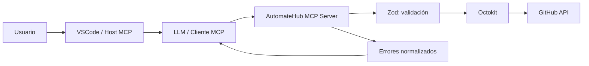

# AutomateHub

Servidor MCP en TypeScript que conecta un LLM con la API de GitHub mediante tools especializadas. El proyecto forma parte del curso de soyHenry Módulo 5 y tiene un objetivo principalmente didáctico: comprender cómo se construye, valida, prueba y conecta un MCP server.

## Objetivos

- Exponer operaciones de GitHub como tools MCP.
- Validar los inputs antes de llamar a la API.
- Normalizar respuestas y errores para que sean comprensibles por un LLM.
- Usar Octokit como cliente de GitHub.
- Probar la lógica con mocks, sin depender de una cuenta real ni de la red.

## Tecnologías

- TypeScript y Node.js.
- [`@modelcontextprotocol/sdk`](https://github.com/modelcontextprotocol/typescript-sdk).
- [`@octokit/rest`](https://github.com/octokit/rest.js).
- [`zod`](https://zod.dev/) para validación.
- [`vitest`](https://vitest.dev/) para tests unitarios.
- `dotenv` para variables de entorno.
- Transporte MCP `stdio`.

## Arquitectura



El Host MCP utiliza la configuración de [`.mcp.json`](./.mcp.json) en la raíz del proyecto. El servidor se comunica con el Host mediante `stdio`; Octokit se encarga de las llamadas a GitHub.

## Requisitos

- Node.js compatible con el proyecto.
- npm.
- Un GitHub Personal Access Token configurado localmente.
- Un Host MCP compatible con la configuración del workspace.

## Instalación

```bash
npm install
```

Crear un archivo `.env` a partir de [`.env.example`](./.env.example):

```env
GITHUB_TOKEN=tu_token_de_github
DEFAULT_OWNER=
DEFAULT_REPO=
```

`.env` contiene secretos y no debe subirse al repositorio. El servidor valida que `GITHUB_TOKEN` exista al iniciar.

## GitHub Personal Access Token

AutomateHub necesita un GitHub Personal Access Token (PAT) para autenticarse con Octokit. El token debe pertenecer a la cuenta que ejecutará las operaciones y debe tener únicamente los permisos necesarios.

### Creación del token

1. En GitHub, abre **Settings → Developer settings → Personal access tokens**.
2. Elige **Fine-grained tokens** cuando sea posible.
3. Define una fecha de expiración corta o razonable y limita el token a los repositorios que AutomateHub necesita utilizar.
4. Concede solo los permisos requeridos por las tools:

   | Operación | Permiso mínimo esperado |
   | --- | --- |
   | Consultar repositorios | `Metadata: Read-only` |
   | Crear repositorios | Permisos de administración de repositorios que GitHub solicite para esa operación |
   | Crear o listar issues | `Issues: Read and write` |
   | Crear o actualizar archivos con commits | `Contents: Read and write` |

   Los nombres y niveles exactos pueden variar entre tokens fine-grained y classic. Antes de usar un permiso amplio, revisa si el repositorio puede limitarse a una selección concreta.

5. Genera el token y cópialo inmediatamente; GitHub no vuelve a mostrarlo completo.

### Configuración local

Crea `.env` a partir de [`.env.example`](./.env.example) y coloca el token sin comillas:

```env
GITHUB_TOKEN=github_pat_tu_token
DEFAULT_OWNER=
DEFAULT_REPO=
```

No uses el token directamente en el código, no lo pongas en prompts, issues, commits, capturas, logs ni archivos Markdown. `.env` debe permanecer fuera del control de versiones.

### Diagnóstico y mantenimiento

- Token ausente: el servidor no puede autenticarse al iniciar o al llamar a GitHub.
- Token inválido o expirado: GitHub responde normalmente con `401`.
- Permiso insuficiente: GitHub responde normalmente con `403`.
- Repositorio no incluido en el alcance del token: una operación sobre ese repositorio puede responder `404` o `403`.
- Si el token se filtra, revócalo desde la configuración de GitHub, crea uno nuevo y reemplázalo en `.env`.
- Revisa periódicamente la fecha de expiración y elimina tokens que ya no utilices.

## Compilación y servidor MCP

El Host utiliza el archivo generado `dist/index.js`, por lo que primero debe generarse la compilación:

```bash
npm run build
```

La configuración MCP activa del workspace es:

```json
{
  "mcpServers": {
    "automateHub-mcp-server": {
      "type": "stdio",
      "command": "node",
      "args": ["dist/index.js"],
      "env": ".env"
    }
  }
}
```

Después de compilar, el Host puede iniciar `automateHub-mcp-server` mediante [`.mcp.json`](./.mcp.json). La configuración no contiene el token; indica que el proceso debe cargar las variables desde `.env`. El comando usa `dist/index.js`, por lo que es necesario ejecutar `npm run build` después de modificar el código fuente. `dist/` es un artefacto generado y no debe editarse manualmente.

## Tools

Las tools registradas actualmente se encuentran en [`src/tools/index.tools.ts`](./src/tools/index.tools.ts).

### `create_repository`

Crea un repositorio nuevo en la cuenta autenticada.

- Escritura en GitHub.
- `name`: obligatorio, entre 3 y 100 caracteres, solo letras, números y guiones.
- `description`: opcional.
- `private`: opcional; por defecto `false`.

Prompt efectivo:

> Crea un repositorio privado llamado `automatehub-demo` con la descripción `Repositorio de pruebas para AutomateHub`.

### `create_issue`

Crea una issue en un repositorio accesible por la cuenta autenticada.

- Escritura en GitHub.
- `owner`, `repo` y `title`: obligatorios.
- `body`, `labels` y `assignees`: opcionales.

Prompt efectivo:

> Crea una issue en `owner/repo` con el título `Documentar configuración MCP`, una descripción breve y la etiqueta `documentation`.

### `create_commit`

Crea o actualiza un archivo mediante la API de contenidos de GitHub.

- Escritura en GitHub.
- `owner`, `repo`, `message`, `content` y `path`: obligatorios.
- `branch` y `sha`: opcionales.
- `path` debe ser relativa al repositorio; no se aceptan rutas absolutas.

Prompt efectivo:

> En `owner/repo`, crea o actualiza `docs/architecture.md` en la rama `main` con un commit llamado `Document architecture` y el contenido que te proporciono.

### `list_issues`

Lista issues de un repositorio y excluye pull requests de la respuesta.

- Lectura de GitHub.
- `owner` y `repo`: obligatorios.
- `state`: `open`, `closed` o `all`; por defecto `open`.
- `sort`: `created`, `updated` o `comments`; por defecto `created`.
- `direction`: `asc` o `desc`; por defecto `desc`.
- `per_page`: entre 1 y 100; por defecto `30`.
- `page`: página positiva; por defecto `1`.

Prompt efectivo:

> Lista las 10 issues abiertas más recientes de `owner/repo`, ordenadas por fecha de actualización.

### `list_repositories`

Lista repositorios de la cuenta autenticada.

- Lectura de GitHub.
- `type`: `all`, `public` o `private`; por defecto `all`.
- `sort`: `created`, `updated`, `pushed` o `full_name`; por defecto `updated`.
- `per_page`: entre 1 y 100; por defecto `3`.

### `ping`

Health check local del servidor. Devuelve `pong` o `pong: mensaje` y no llama a GitHub.

## Tools planificadas

### `get_repository`

Tool de solo lectura propuesta para consultar un repositorio mediante `owner` y `repo`, devolviendo su nombre completo, URL, descripción, visibilidad, propietario y rama principal. La especificación de terminación establece que debe ser una tool oficial, pero actualmente [su archivo](./src/tools/github/get_repository.ts) no está registrado en [el índice de tools](./src/tools/index.tools.ts). Por eso no debe considerarse disponible todavía.

### `read_file`

Tool propuesta en [`docs/spec-fixtools.md`](./docs/spec-fixtools.md) para leer un archivo y devolver su contenido junto con el `sha` del blob. Ese `sha` permitiría actualizar de forma segura un archivo existente mediante `create_commit`, por ejemplo `wiseArchive/README.md`. Actualmente no existe una implementación registrada.

## Validación y errores

Cada tool usa un schema de Zod para validar sus argumentos. Los errores se devuelven con una estructura uniforme:

```json
{
  "ok": false,
  "error": {
    "type": "GitHubNotFoundError",
    "message": "Recurso no encontrado..."
  }
}
```

La capa de errores contempla autenticación inválida (`401`), permisos insuficientes (`403`), recurso inexistente (`404`), validación de GitHub (`422`), rate limit y errores del servidor.

## Tests

Los tests deben ejecutarse exclusivamente contra mocks de Octokit y no deben depender de:

- una cuenta real de GitHub;
- `GITHUB_TOKEN`;
- acceso a Internet;
- creación o modificación de repositorios, issues o commits reales.

La suite cubre schemas, transformación de respuestas, exclusión de pull requests y normalización de errores. La configuración del proyecto incluye además tests mockeados para clientes y handlers. Para ejecutarla:

```bash
npm test
```

### Matriz de requisitos y tests

La siguiente matriz relaciona los requisitos del proyecto con la evidencia esperada. Los tests deben ejecutarse con mocks y no deben utilizar un token real ni modificar GitHub.

| Requisito | Evidencia o archivo relacionado | Estado documentado |
| --- | --- | --- |
| `create_repository` | Tool registrada, schema y tests de cliente/handler | Implementado |
| `create_issue` | Tool registrada, schema y tests de cliente/handler | Implementado |
| `create_commit` | Tool registrada, validación de rutas y test de contenido Base64 | Implementado |
| `list_issues` | Tool registrada, paginación y exclusión de pull requests | Implementado |
| Schemas válidos e inválidos | `src/tests/schemas.test.ts` | Implementado |
| Octokit mockeado | `src/tests/clients.test.ts` | Implementado |
| Casos edge | Pull requests, rutas absolutas, paginación y campos opcionales | Parcial; ampliar evidencia si falta algún caso |
| Errores `401`, `403`, `404`, `422`, rate limit y `5xx` | `src/tests/errors.test.ts` y `src/clients/github/errors.ts` | Implementado en la capa de errores; confirmar cobertura completa |
| Mensajes legibles para el LLM | `src/tools/github/result.ts` y tests de errores | Implementado |
| Configuración MCP | `.mcp.json`, `dist/index.js` y descubrimiento desde el Host | Verificado después de compilar |
| README, prompts y arquitectura | Este README y diagrama Mermaid | Implementado |
| Guía del PAT | Sección “GitHub Personal Access Token” | Implementado |
| `get_repository` | `src/tools/github/get_repository.ts` | Pendiente |
| `read_file` y resolución de `sha` | [`docs/spec-fixtools.md`](./docs/spec-fixtools.md) | Pendiente |

La suite mínima exigida por el prompt es de ocho tests unitarios. La cantidad exacta y el resultado de la última ejecución deben comprobarse con `npm test`; esta documentación no reemplaza esa ejecución.

## Documentación del uso de IA

La bitácora y los criterios utilizados durante la creación del proyecto están en [`docs/uso-ia.md`](./docs/uso-ia.md). También se conserva la especificación de terminación en [`docs/spec-terminacion.md`](./docs/spec-terminacion.md).

## Seguridad y límites

- Las tools de escritura pueden modificar GitHub; deben utilizarse con una confirmación clara del usuario.
- Los tests no realizan operaciones reales.
- El token nunca debe aparecer en el código fuente ni en la documentación.
- Los reintentos de la capa GitHub deben tratarse con cuidado, especialmente en operaciones de escritura.
- `dist/` es un artefacto generado y no debe editarse manualmente.

## Estado del proyecto

La base del servidor, las tools principales, la validación y los tests unitarios están implementados. Actualmente están registradas `create_repository`, `create_issue`, `create_commit`, `list_issues`, `list_repositories` y `ping`. La documentación de terminación se encuentra en [`docs/spec-terminacion.md`](./docs/spec-terminacion.md); la propuesta para lectura de archivos y resolución de `sha` se encuentra en [`docs/spec-fixtools.md`](./docs/spec-fixtools.md).

Permanecen pendientes `get_repository` —requerida por la especificación de terminación— y `read_file` —necesaria para leer archivos y obtener su `sha` antes de actualizarlos—. Ninguna de las dos debe considerarse disponible hasta que sea implementada, registrada y cubierta por tests.
