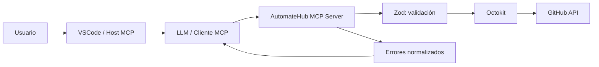

# AutomateHub

Servidor MCP en TypeScript que conecta un LLM con la API de GitHub mediante tools especializadas. El proyecto forma parte del SoyHenry Módulo 5 y tiene un objetivo principalmente didáctico: comprender cómo se construye, valida, prueba y conecta un MCP server.

## Objetivos

- Exponer operaciones de GitHub como tools MCP.
- Validar los inputs antes de llamar a la API.
- Normalizar respuestas y errores para que sean comprensibles por un LLM.
- Usar Octokit como cliente de GitHub.
- Probar la lógica con mocks, sin depender de una cuenta real ni de la red.

## Tecnologías

- TypeScript y Node.js.
- [`@modelcontextprotocol/sdk`](https://github.com/modelcontextprotocol/typescript-sdk).
- [`@octokit/rest`](https://github.com/octokit/rest.js).
- [`zod`](https://zod.dev/) para validación.
- [`vitest`](https://vitest.dev/) para tests unitarios.
- `dotenv` para variables de entorno.
- Transporte MCP `stdio`.

## Arquitectura



VSCode actúa como Host MCP y utiliza la configuración de [`.codex/mcp.json`](./.codex/mcp.json). El servidor se comunica con el Host mediante `stdio`; Octokit se encarga de las llamadas a GitHub.

## Requisitos

- Node.js compatible con el proyecto.
- npm.
- Un GitHub Personal Access Token configurado localmente.
- VSCode con soporte para la configuración MCP utilizada por este workspace.

## Instalación

```bash
npm install
```

Crear un archivo `.env` a partir de [`.env.example`](./.env.example):

```env
GITHUB_TOKEN=tu_token_de_github
DEFAULT_OWNER=
DEFAULT_REPO=
```

`.env` contiene secretos y no debe subirse al repositorio. El servidor valida que `GITHUB_TOKEN` exista al iniciar.

## GitHub Personal Access Token

El token debe tener únicamente los permisos necesarios para las operaciones que se quieran utilizar. Según el tipo de token y la configuración de la cuenta, pueden ser necesarios permisos para:

- repositorios, para crear o consultar repositorios;
- issues, para crear y listar issues;
- contents, para crear o actualizar archivos mediante commits.

Nunca copies un token real en el README, en los tests, en capturas de pantalla ni en logs. Si el token se filtra, revócalo y crea uno nuevo desde GitHub.

## Compilación y servidor MCP

El Host utiliza el archivo generado `dist/index.js`, por lo que primero debe generarse la compilación:

```bash
npm run build
```

La configuración MCP del workspace es:

```json
{
  "servers": {
    "AutomateHub-Agent": {
      "type": "stdio",
      "command": "node",
      "args": ["${workspaceFolder}/dist/index.js"],
      "envFile": "${workspaceFolder}/.env"
    }
  }
}
```

Después de compilar, VSCode puede iniciar el servidor a través de [`.codex/mcp.json`](./.codex/mcp.json). La configuración no contiene el token; solo indica que debe cargarse desde `.env`.

## Tools

Las tools registradas actualmente se encuentran en [`src/tools/index.tools.ts`](./src/tools/index.tools.ts).

### `create_repository`

Crea un repositorio nuevo en la cuenta autenticada.

- Escritura en GitHub.
- `name`: obligatorio, entre 3 y 100 caracteres, solo letras, números y guiones.
- `description`: opcional.
- `private`: opcional; por defecto `false`.

Prompt efectivo:

> Crea un repositorio privado llamado `automatehub-demo` con la descripción `Repositorio de pruebas para AutomateHub`.

### `create_issue`

Crea una issue en un repositorio accesible por la cuenta autenticada.

- Escritura en GitHub.
- `owner`, `repo` y `title`: obligatorios.
- `body`, `labels` y `assignees`: opcionales.

Prompt efectivo:

> Crea una issue en `owner/repo` con el título `Documentar configuración MCP`, una descripción breve y la etiqueta `documentation`.

### `create_commit`

Crea o actualiza un archivo mediante la API de contenidos de GitHub.

- Escritura en GitHub.
- `owner`, `repo`, `message`, `content` y `path`: obligatorios.
- `branch` y `sha`: opcionales.
- `path` debe ser relativa al repositorio; no se aceptan rutas absolutas.

Prompt efectivo:

> En `owner/repo`, crea o actualiza `docs/architecture.md` en la rama `main` con un commit llamado `Document architecture` y el contenido que te proporciono.

### `list_issues`

Lista issues de un repositorio y excluye pull requests de la respuesta.

- Lectura de GitHub.
- `owner` y `repo`: obligatorios.
- `state`: `open`, `closed` o `all`; por defecto `open`.
- `sort`: `created`, `updated` o `comments`; por defecto `created`.
- `direction`: `asc` o `desc`; por defecto `desc`.
- `per_page`: entre 1 y 100; por defecto `30`.
- `page`: página positiva; por defecto `1`.

Prompt efectivo:

> Lista las 10 issues abiertas más recientes de `owner/repo`, ordenadas por fecha de actualización.

### `list_repositories`

Lista repositorios de la cuenta autenticada.

- Lectura de GitHub.
- `type`: `all`, `public` o `private`; por defecto `all`.
- `sort`: `created`, `updated`, `pushed` o `full_name`; por defecto `updated`.
- `per_page`: entre 1 y 100; por defecto `3`.

### `ping`

Health check local del servidor. Devuelve `pong` o `pong: mensaje` y no llama a GitHub.

### Próxima tool: `get_repository`

La especificación del proyecto requiere crear y registrar `get_repository`. Actualmente su archivo es un esqueleto y todavía no debe considerarse una tool disponible. Su implementación se realizará después de aprobar una propuesta de cambios de código.

## Validación y errores

Cada tool usa un schema de Zod para validar sus argumentos. Los errores se devuelven con una estructura uniforme:

```json
{
  "ok": false,
  "error": {
    "type": "GitHubNotFoundError",
    "message": "Recurso no encontrado..."
  }
}
```

La capa de errores contempla autenticación inválida (`401`), permisos insuficientes (`403`), recurso inexistente (`404`), validación de GitHub (`422`), rate limit y errores del servidor.

## Tests

Los tests deben ejecutarse exclusivamente contra mocks de Octokit y no deben depender de:

- una cuenta real de GitHub;
- `GITHUB_TOKEN`;
- acceso a Internet;
- creación o modificación de repositorios, issues o commits reales.

La suite cubre schemas, transformación de respuestas, exclusión de pull requests y normalización de errores. Para ejecutarla:

```bash
npm test
```

## Documentación del uso de IA

La bitácora y los criterios utilizados durante la creación del proyecto están en [`docs/uso-ia.md`](./docs/uso-ia.md). También se conserva la especificación de terminación en [`docs/spec-terminacion.md`](./docs/spec-terminacion.md).

## Seguridad y límites

- Las tools de escritura pueden modificar GitHub; deben utilizarse con una confirmación clara del usuario.
- Los tests no realizan operaciones reales.
- El token nunca debe aparecer en el código fuente ni en la documentación.
- Los reintentos de la capa GitHub deben tratarse con cuidado, especialmente en operaciones de escritura.
- `dist/` es un artefacto generado y no debe editarse manualmente.

## Estado del proyecto

La base del servidor, las tools principales, la validación y los tests unitarios están implementados. La documentación está en proceso de consolidación y `get_repository` permanece pendiente de implementación y registro.
