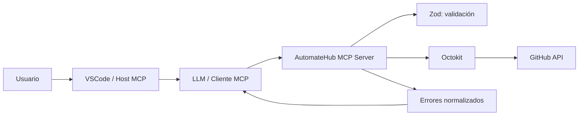

# Especificación de terminación — AutomateHub

## 1. Objetivo

Completar la entrega del servidor MCP **AutomateHub**, integrado con la API de GitHub, de acuerdo con los requisitos definidos en [`docs/prompt.json`](../prompt.json).

Esta especificación se limita a definir el trabajo pendiente y sus criterios de aceptación. No implica todavía cambios en el código de implementación.

## 2. Estado actual observado

### Cumplido o prácticamente cumplido

- Existe un servidor MCP por `stdio` en [`src/index.ts`](../../src/index.ts).
- Las cuatro tools mínimas están implementadas y registradas:
  - `create_repository`
  - `create_issue`
  - `create_commit`
  - `list_issues`
- Hay schemas de Zod para las entradas y salidas en [`src/schemas/`](../../src/schemas).
- La validación de nombres de repositorio exige entre 3 y 100 caracteres, usando letras, números y guiones.
- Existe una capa común para transformar errores de GitHub a mensajes legibles en [`src/clients/github/errors.ts`](../../src/clients/github/errors.ts) y [`src/tools/github/result.ts`](../../src/tools/github/result.ts).
- Existe configuración MCP para el workspace en [`.mcp.json`](../../.mcp.json).
- Hay tests unitarios con Vitest para schemas, clientes, errores y un handler.
- La configuración de entorno está centralizada en [`src/config/env.ts`](../../src/config/env.ts), y el secreto se mantiene fuera del repositorio mediante `.env`.

### Parcial o pendiente

- No existe un `README.md` profesional para la entrega.
- No existe documentación completa de cada tool con ejemplos de prompts efectivos.
- No existe el diagrama de arquitectura solicitado.
- No existe una guía documentada para crear y configurar el GitHub Personal Access Token.
- No hay una matriz de cobertura que demuestre explícitamente cada requisito de testing.
- La configuración disponible está en `.mcp.json`; debe confirmarse si también se requiere una configuración específica para `.vscode/mcp.json` o Antigravity.
- Debe verificarse, mediante una revisión posterior, que el servidor pueda iniciarse desde la configuración MCP y que el cliente MCP pueda descubrir y llamar las tools.
- Debe revisarse si `get_repository` forma parte del alcance final: existe un archivo con ese nombre, pero no está registrado entre las tools mínimas.

## 3. Alcance de trabajo propuesto

### 3.1 README profesional

Crear `README.md` en la raíz con estas secciones mínimas:

1. Nombre y propósito del proyecto.
2. Objetivos didácticos del MCP.
3. Tecnologías utilizadas.
4. Requisitos previos.
5. Instalación de dependencias.
6. Configuración de `.env` a partir de `.env.example`.
7. Permisos mínimos del token de GitHub.
8. Cómo iniciar el servidor MCP.
9. Cómo conectarlo desde VSCode/Host compatible.
10. Catálogo de tools.
11. Ejemplos de prompts.
12. Estrategia de errores y reintentos.
13. Ejecución de tests.
14. Limitaciones y consideraciones de seguridad.

### 3.2 Documentación de las tools

Para cada tool se debe documentar:

- Propósito y efecto: lectura o escritura.
- Parámetros requeridos y opcionales.
- Valores por defecto y límites.
- Ejemplo de entrada conceptual.
- Prompt efectivo para un LLM.
- Respuesta exitosa esperada.
- Errores frecuentes: `401`, `403`, `404`, `422`, rate limit y errores del servidor.
- Advertencia cuando la operación modifica GitHub.

Las cuatro tools obligatorias son `create_repository`, `create_issue`, `create_commit` y `list_issues`. `list_repositories` puede documentarse como tool adicional existente.

### 3.3 Diagrama de arquitectura

Incluir en el README un diagrama Mermaid equivalente a:

El diagrama debe dejar claro que VSCode/Host coordina, el LLM decide qué tool usar, el servidor ejecuta la operación y GitHub es el sistema externo afectado.

### 3.4 Guía del GitHub Personal Access Token

Documentar:

- Creación del token desde GitHub.
- Recomendación de usar un token de mínimo privilegio.
- Permisos necesarios según las operaciones:
  - repositorios para crear/listar repositorios;
  - issues para crear/listar issues;
  - contents para crear o actualizar archivos mediante commits.
- Configuración en `.env` con `GITHUB_TOKEN`.
- Prohibición de subir `.env` al repositorio.
- Cómo reconocer un token ausente, inválido, expirado o sin permisos.
- Revocación y rotación del token.

La documentación debe evitar mostrar tokens reales.

### 3.5 Configuración del Host MCP

Documentar la configuración existente en [`.mcp.json`](../../.mcp.json) y resolver una decisión de entrega:

- **Opción A:** conservar `.mcp.json` como configuración del entorno utilizado durante el curso.
- **Opción B:** añadir una configuración equivalente para VSCode si el Host objetivo la requiere.
- **Opción C:** documentar ambas, indicando que solo debe mantenerse activa la que corresponda al Host utilizado.

La configuración final debe:

- apuntar a `dist/index.js` después de compilar;
- cargar `.env` sin exponer secretos;
- usar transporte `stdio`;
- permitir descubrir las tools registradas;
- dejar claro que `dist/` se genera y no debe editarse manualmente.

## 4. Revisión técnica pendiente

Antes de dar la entrega por finalizada se debe revisar, sin cambiar el alcance:

1. Que las cuatro tools mínimas estén registradas en el servidor.
2. Que cada schema rechace inputs claramente inválidos.
3. Que los valores enviados a Octokit coincidan con los parámetros documentados.
4. Que los errores de autenticación, permisos, recurso inexistente, validación, rate limit y servidor tengan una salida comprensible.
5. Que los reintentos no oculten indefinidamente un fallo ni hagan operaciones de escritura duplicadas.
6. Que las operaciones destructivas o de escritura estén marcadas claramente en la documentación.
7. Que `get_repository` se registre o se declare explícitamente fuera del alcance.
8. Que no se filtren `GITHUB_TOKEN`, cabeceras de autorización ni secretos en logs, tests o README.

## 5. Plan de tests requerido

La suite actual supera el mínimo numérico de 8 casos, pero la evidencia final debe organizarse por requisito:

| Área | Evidencia mínima esperada |
|---|---|
| Schemas | Inputs válidos, campos obligatorios, límites, defaults y nombres inválidos |
| Octokit mockeado | Creación de repositorio, issue y commit; listado de issues |
| Casos edge | Pull requests excluidos, rutas absolutas, paginación, campos opcionales |
| Errores GitHub | `401`, `403`, `404`, `422`, rate limit y `5xx` |
| Mensajes | Conversión a resultado MCP legible para el LLM |
| Integración MCP | Descubrimiento de tools y llamada controlada a una tool, si el entorno lo permite |

La prueba de integración debe ser opcional respecto de los tests unitarios y nunca debe depender de un token real ni modificar una cuenta real.

## 6. Entregables finales

- `README.md` profesional en la raíz.
- Documentación de tools y prompts efectivos.
- Diagrama de arquitectura incluido en el README.
- Guía de Personal Access Token y seguridad.
- Decisión documentada sobre `.mcp.json`, VSCode y/o Antigravity.
- Matriz de requisitos y tests.
- Código existente revisado únicamente donde sea necesario para cerrar los requisitos.
- Evidencia de validación final, sin secretos.

## 7. Criterios de aceptación

El trabajo se considerará terminado cuando:

- una persona nueva pueda instalar, configurar y entender el proyecto leyendo el README;
- pueda identificar qué tools leen y cuáles escriben en GitHub;
- pueda conectar el servidor desde el Host documentado;
- pueda entender los parámetros, respuestas y errores de cada tool;
- el token nunca aparezca en archivos versionados, documentación ni salida de diagnóstico;
- los tests cubran los requisitos mínimos indicados en el prompt;
- cualquier funcionalidad existente fuera del alcance esté claramente identificada;
- la revisión final no requiera inventar pasos críticos que no estén documentados.

## 8. Decisiones confirmadas

1. **Host objetivo:** se utilizarán `.codex` y VSCode. La configuración `.codex` se consumirá desde VSCode, por lo que la documentación debe explicar esa relación y evitar presentar ambos como servidores distintos.
2. **`get_repository`:** debe crearse, registrarse como tool oficial y documentarse junto con las demás tools.
3. **Cambios de código:** están autorizados únicamente después de presentar una explicación concreta de los cambios propuestos y recibir aprobación explícita. Esta especificación no autoriza todavía modificaciones de implementación.
4. **GitHub real:** el proyecto está conectado a una cuenta real mediante `GITHUB_TOKEN`, pero ninguna prueba ni verificación del plan debe llamar a GitHub real. Todos los tests deben ejecutarse contra mocks, sin depender de la cuenta real, del token ni de la red, y sin crear o modificar recursos externos.

## 9. Consecuencias de las decisiones

- La configuración MCP debe documentarse como una integración `.codex` utilizada desde VSCode.
- El alcance funcional pasa a incluir cinco tools oficiales: `create_repository`, `get_repository`, `create_issue`, `create_commit` y `list_issues`. `list_repositories` continúa como tool adicional ya existente, salvo que se decida incorporarla formalmente al catálogo principal.
- Antes de tocar cualquier archivo de código se presentará una propuesta por archivo, indicando qué se cambiará, por qué, qué requisito cubre y cómo se verificará.
- La documentación debe indicar que toda la validación del proyecto se realiza con tests seguros y reproducibles mediante mocks.
- El uso de un token real no forma parte de los tests: el token permite la conexión del servidor con GitHub cuando se use fuera de la suite, mientras que los mocks permiten probar errores y comportamientos sin efectos externos.
